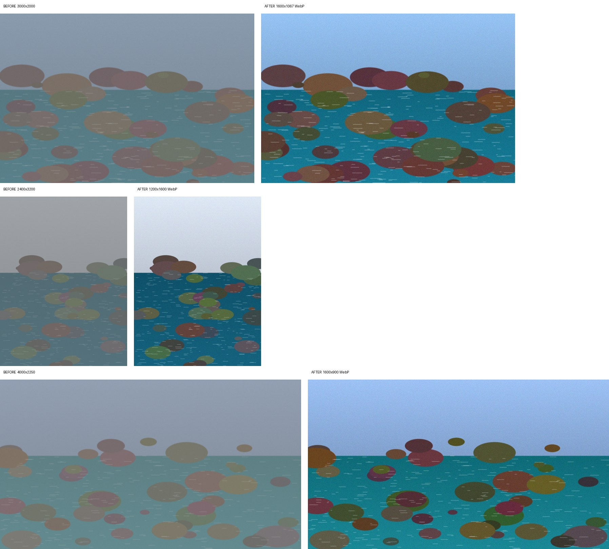

# سير عمل PhotoCraft لتجهيز صور الموقع

يعتمد على [PhotoCraft](https://github.com/storytold/photocraft) (أداة سطر الأوامر `photocraft-cli`).

> ✅ مُختبر على PhotoCraft v0.16.0 (3 صور تجريبية مولَّدة، 3 نجحت، 0 فشلت).

## الخطوات (`web-images.json`)
1. `file.automate.fitImage`: احتواء الصورة داخل مربع 1600×1600 (الطولية والعرضية) دون تكبير الصور الصغيرة
2. `image.autoContrast`: تحسين التباين مع الحفاظ على الألوان
3. `filter.sharpen.smartSharpen`: زيادة الوضوح بعد التصغير

> لماذا Auto Contrast وليس Auto Tone؟ في الاختبار، Auto Tone يمطّ كل قناة لونية وحدها، فتغيّرت الألوان (السماء الزرقاء صارت وردية). Auto Contrast يحسّن التباين دون تغيير الألوان.

ثم الحفظ بصيغة WebP بجودة 82.

## نتائج الاختبار

| الصورة | قبل | بعد |
|---|---|---|
| spring-1 | 3000×2000 · 2.19MB | 1600×1067 · 0.38MB |
| spring-2 (طولية) | 2400×3200 · 2.79MB | 1200×1600 · 0.44MB |
| spring-3 | 4000×2250 · 17.5MB (PNG) | 1600×900 · 0.29MB |

الوقت: نحو 8 ثوانٍ للصور الثلاث.



## التشغيل
```sh
cargo install --path apps/photocraft-cli --locked   # من داخل مستودع PhotoCraft
./process.sh ./raw ./web
```

## الربط مع Claude عبر MCP
```sh
claude mcp add photocraft -- photocraft-cli mcp \
  --automation-read-root /path/to/images --automation-write-root /path/to/images
```
